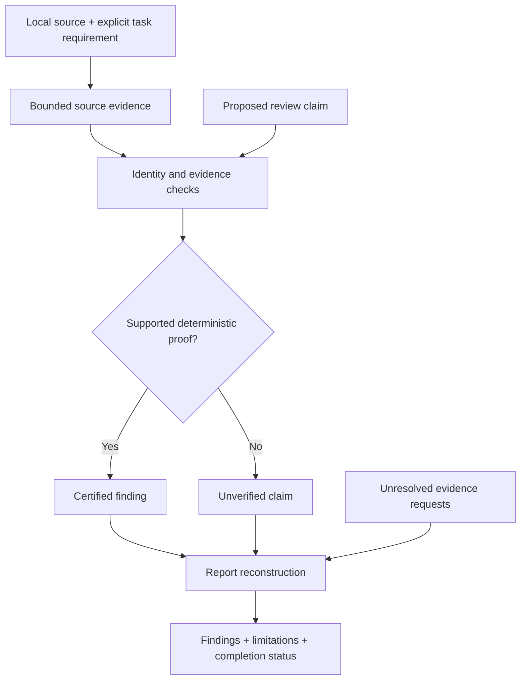

<div align="center">

# AI Council

**Evidence before consensus.**

An experimental foundation for evidence-grounded AI review.

[](https://github.com/Pipirasas/AI-Council-Experimental/actions/workflows/offline-tests.yml)
[](docs/LIMITATIONS.md)
[](#quick-start)
[](LICENSE)

[Quick start](#quick-start) · [Demo](#what-the-demo-shows) · [Architecture](#how-the-core-fits-together) · [Contribute](#build-with-us) · [Roadmap](docs/ROADMAP.md)

**English** · [Lietuviškai](README_LT.md)

</div>

---

## The question we are working on

**Can multiple AI reviewers reach more reliable conclusions than one strong model at a comparable total budget?**

AI Council is a research project built around that question. This repository starts with a smaller, testable prerequisite: checking whether a review claim is supported by the source evidence it cites.

> [!IMPORTANT]
> **R0 is the offline evidence-audit core, not the complete multi-agent Council.** It contains no live agents, model runner or UI. Superiority over a strong single-model baseline **has not been demonstrated**.

## What you can try today

| In R0 | Why it matters |
| --- | --- |
| Source paths, numbered excerpts and exact-byte checks | A citation must refer to the source that was actually inspected. |
| Narrow deterministic claim checks | A real file is not sufficient proof that an explanation is correct. |
| Evidence reconciliation and incomplete-request accounting | Conflicting or missing evidence must not silently become a confident conclusion. |
| Synthetic regression tests and an offline demo | Contributors can investigate behavior without model access or private datasets. |

**Not included:** multi-agent orchestration, LLM execution, model routing, a benchmark runner, production integrations or private evaluation material. See [the scope and limitations](docs/LIMITATIONS.md).

## Quick start

**Python 3.12+ · standard library only · no API keys · no model downloads**

Get a local copy, then run these commands from the repository root:

```bash
git clone https://github.com/Pipirasas/AI-Council-Experimental.git
cd AI-Council-Experimental
python -B -m examples.offline_demo
python -B -m unittest discover -s tests -v
python -B scripts/check_public_tree.py
```

The Python commands work in PowerShell as well as a typical Linux shell. While this repository is private, cloning requires access; after obtaining the source, the demo and tests run offline. There is no package installation step.

<details>
<summary><strong>Already have the source? Run only these three commands</strong></summary>

```bash
python -B -m examples.offline_demo
python -B -m unittest discover -s tests -v
python -B scripts/check_public_tree.py
```

The path check is a limited repository-content check, **not** a complete secrets, ownership or security audit. See [SECURITY.md](SECURITY.md).

</details>

## What the demo shows

A disposable synthetic program subtracts two arguments. An explicit synthetic requirement says it must return their sum. The demo compares the same proposed finding with and without that independent requirement.

```json
{
  "claim": "Supported only for the explicitly parsed arithmetic subset",
  "demo": "synthetic_offline_only",
  "model_calls": 0,
  "target_code_executed": false,
  "verified_with_authority": 1,
  "verified_without_authority": 0
}
```

**What this establishes:** one supported source-level mismatch is retained; the unsupported attribution is withheld. The target program is not executed or imported. This is not a comprehensive code audit or a multi-model performance result.

## How the core fits together

The diagram shows the core's responsibilities and trust boundaries, **not an implemented live-agent workflow**. The demo exercises a bounded part of these interfaces.



A verified citation is not automatically a verified conclusion. `INCOMPLETE` is not `COMPLETE`, and **zero verified bugs does not mean bug-free software**.

[Explore the architecture and module map →](docs/ARCHITECTURE.md)

## Build with us

We are looking for **small, reproducible contributions**, not large batches of speculative findings. You do not need an LLM subscription, special hardware or private evaluation access to work on the R0 core.

| Your interest | A useful starting point |
| --- | --- |
| A first contribution | [Incomplete-evidence demo or newcomer quickstart](docs/GOOD_FIRST_ISSUES.md) |
| Python testing | [Cross-platform fixtures and source consistency](docs/GOOD_FIRST_ISSUES.md) |
| API design | [Evidence-result contract and report rendering](docs/GOOD_FIRST_ISSUES.md) |
| Evaluation research | [A fair, cost-matched comparison protocol](docs/EVALUATION_PROTOCOL.md) |

Start with the [seven scoped contribution proposals](docs/GOOD_FIRST_ISSUES.md), then follow [CONTRIBUTING.md](CONTRIBUTING.md). These proposals are a backlog, not seven already-open GitHub Issues. Coordinate scope through an Issue before implementing a substantial change.

## From R0 to the research goal

**Now:** offline evidence checks, synthetic tests and a contributor foundation.<br>
**Next:** clearer evidence contracts, portability and reporting.<br>
**Later:** controlled model adapters, followed by a preregistered comparison against a strong single model.

The evaluation must account for **all** tokens, calls, retries, wall time and failure handling—not just the final answer. [Roadmap](docs/ROADMAP.md) · [Evaluation protocol](docs/EVALUATION_PROTOCOL.md)

## Project information

| | |
| --- | --- |
| Maintainer | [@Pipirasas](https://github.com/Pipirasas) · [Governance](GOVERNANCE.md) |
| License | [Apache-2.0](LICENSE) |
| Questions and proposals | [GitHub Issues](https://github.com/Pipirasas/AI-Council-Experimental/issues) · [Contact policy](CONTACT.md) |
| Sensitive reports | Follow [SECURITY.md](SECURITY.md); do not post private code or credentials in Issues. |
| Further reading | [Limitations](docs/LIMITATIONS.md) · [Code of conduct](CODE_OF_CONDUCT.md) · [Changelog](CHANGELOG.md) |

**Experimental research preview.** Interfaces may change. Do not use R0 as the sole basis for safety-critical or security-critical decisions. Public publication remains a separate maintainer decision; this presentation does not change repository visibility.
