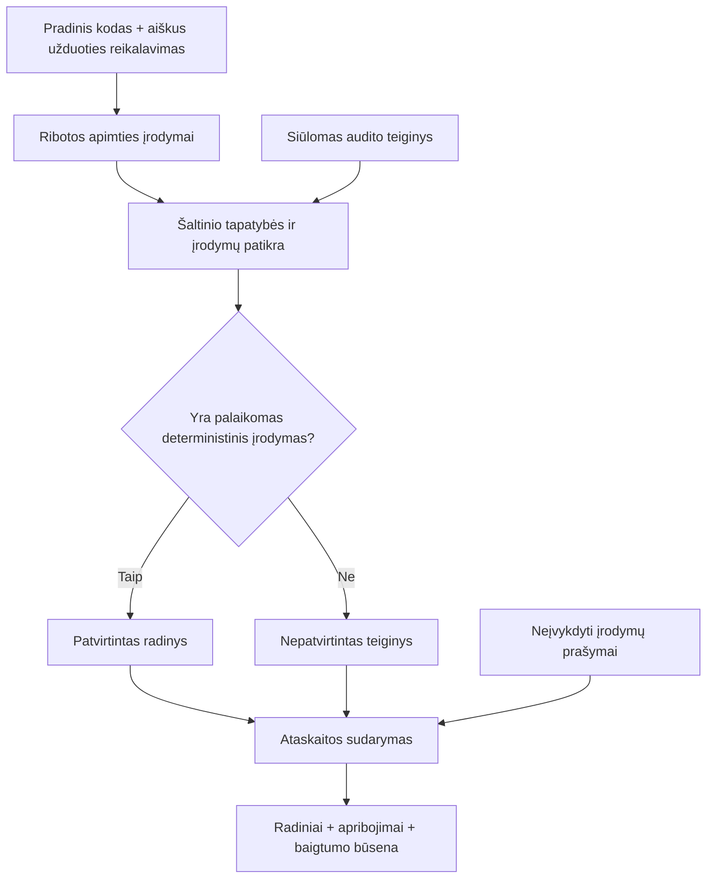

<div align="center">

# AI Council

**Pirmiausia įrodymai, tada sutarimas.**

Eksperimentinis pagrindas įrodymais grindžiamai AI peržiūrai.

[](https://github.com/Pipirasas/AI-Council-Experimental/actions/workflows/offline-tests.yml)
[](docs/LIMITATIONS.md)
[](#paleidimas)
[](LICENSE)

[Paleidimas](#paleidimas) · [Demonstracija](#ką-parodo-demonstracija) · [Architektūra](docs/ARCHITECTURE.md) · [Prisidėjimas](#kaip-prisidėti) · [Planas](docs/ROADMAP.md)

[English](README.md) · **Lietuviškai**

</div>

---

## Kokią problemą tiriame?

**Ar keli AI recenzentai gali pateikti patikimesnes išvadas nei vienas stiprus modelis, kai bendras išteklių biudžetas panašus?**

AI Council tikslas – tai išmatuoti, o ne numanyti. Pradedame nuo mažesnės, patikrinamos užduoties: ar siūloma audito išvada iš tikrųjų pagrįsta cituojamu pradiniu kodu ir įrodymais?

> [!IMPORTANT]
> **R0 yra be modelių veikiantis audito įrodymų branduolys, ne visa kelių agentų AI Council sistema.** Šiame rinkinyje nėra veikiančių AI agentų, modelių vykdymo ar grafinės sąsajos. Pranašumas prieš vieną stiprų modelį **dar neįrodytas**.

## Ką galima išbandyti dabar?

| R0 galimybė | Paskirtis |
| --- | --- |
| Failų kelių, numeruotų ištraukų ir tikslių baitų tikrinimas | Susieti citatą su iš tikrųjų patikrintu šaltiniu. |
| Siauras deterministinis teiginių tikrinimas | Atskirti pagrįstą išvadą nuo paaiškinimo, kuriam nepakanka vien tikro failo. |
| Įrodymų derinimas ir neįvykdytų prašymų apskaita | Neslėpti prieštaringų ar trūkstamų įrodymų. |
| Sintetiniai testai ir demonstracija | Leisti prisidėti be AI modelių, mokamų paslaugų ar privačių duomenų. |

**Neįtraukta:** kelių agentų vykdymo eiga, modelių paleidimas ir parinkimas, palyginamųjų bandymų vykdyklė, gamybinės integracijos bei privatūs vertinimo rinkiniai. [Apribojimai](docs/LIMITATIONS.md).

## Paleidimas

**Python 3.12+ · tik standartinė biblioteka · nereikia API raktų ar modelių**

Gaukite vietinę kopiją ir vykdykite komandas projekto šakniniame kataloge:

```powershell
git clone https://github.com/Pipirasas/AI-Council-Experimental.git
cd AI-Council-Experimental
python -B -m examples.offline_demo
python -B -m unittest discover -s tests -v
python -B scripts/check_public_tree.py
```

Python komandos tinka ir Linux aplinkai. Kol saugykla privati, jos kopijavimui reikia prieigos. Turint failus, testams ir demonstracijai interneto nereikia. Papildomų paketų diegti nereikia.

Jau turėdami kodą, pirmas dvi komandas praleiskite. Failų kelių patikra yra ribota: ji **nepakeičia** visos paslapčių, privatumo ar autorinių teisių peržiūros.

## Ką parodo demonstracija?

Sukuriama laikina sintetinė programa, kuri atima du argumentus. Atskiras aiškus reikalavimas nurodo, kad ji turi juos sudėti. Tas pats siūlomas radinys vertinamas su šiuo reikalavimu ir be jo.

```json
{
  "claim": "Supported only for the explicitly parsed arithmetic subset",
  "demo": "synthetic_offline_only",
  "model_calls": 0,
  "target_code_executed": false,
  "verified_with_authority": 1,
  "verified_without_authority": 0
}
```

Tai parodo vieną siaurai pagrįstą šaltinio neatitikimą ir susilaikymą, kai trūksta autoritetingo reikalavimo. **Tikrinama programa nevykdoma ir neimportuojama.** Tai nėra visapusiškas programos auditas ar kelių modelių našumo palyginimas.

## Kaip susijusios branduolio dalys?

Schema vaizduoja modulių atsakomybes ir pasitikėjimo ribas, **ne veikiančią kelių agentų sistemą**. Demonstracija naudoja tik dalį šių sąsajų.



Tikra citata savaime nepatvirtina išvados. `INCOMPLETE` (neužbaigta) nėra `COMPLETE` (užbaigta), o **nulis patvirtintų klaidų nereiškia, kad programa be klaidų**. [Architektūra ir modulių žemėlapis](docs/ARCHITECTURE.md).

## Kaip prisidėti?

Laukiami nedideli, atkuriami pakeitimai su aiškiais testais. R0 darbams nereikia mokamos AI prenumeratos, specialios vaizdo plokštės ar prieigos prie privačių vertinimo rinkinių.

| Domina | Nuo ko pradėti |
| --- | --- |
| Pirmasis indėlis | Neužbaigto audito demonstracija arba naujoko gidas |
| Python testavimas | Windows / Linux, Unicode ir failų tapatybės testai |
| Sąsajų projektavimas | Įrodymų rezultato sutartis ir ataskaitų pateikimas |
| Tyrimo metodika | Sąžiningas vienodo biudžeto palyginimo protokolas |

[Septynios konkrečios prisidėjimo kryptys](docs/GOOD_FIRST_ISSUES.md) · [Prisidėjimo taisyklės](CONTRIBUTING.md)

Tai pasiūlytų darbų sąrašas, **ne septynios jau sukurtos GitHub Issues užduotys**. Prieš didesnį pakeitimą aptarkite jo ribas atskiroje užduotyje. Techniniai prisidėjimo dokumentai pateikiami anglų kalba.

## Tolimesnė kryptis

**Dabar:** įrodymų branduolys, sintetiniai testai ir pagrindas bendradarbiavimui.<br>
**Toliau:** aiškesnės įrodymų sąsajos, suderinamumas ir ataskaitos.<br>
**Vėliau:** kontroliuojami modelių adapteriai ir iš anksto apibrėžtas palyginimas su vienu stipriu modeliu.

Vertinamas turi būti visas biudžetas: tokenai, kvietimai, pakartojimai, trukmė ir nesėkmių tvarkymas. [Darbų planas](docs/ROADMAP.md) · [Vertinimo protokolas](docs/EVALUATION_PROTOCOL.md)

## Projekto informacija

Projektą prižiūri [@Pipirasas](https://github.com/Pipirasas). Licencija – [Apache-2.0](LICENSE). Klausimams naudokite [GitHub Issues](https://github.com/Pipirasas/AI-Council-Experimental/issues); asmeninis el. paštas neskelbiamas. Jautriems pranešimams taikoma [saugumo politika](SECURITY.md), ne vieši komentarai.

[Kontaktai](CONTACT.md) · [Projekto valdymas](GOVERNANCE.md) · [Elgesio taisyklės](CODE_OF_CONDUCT.md) · [Pakeitimų istorija](CHANGELOG.md)

**Eksperimentinis tyrimo kandidatas.** Sąsajos gali keistis; R0 neturi būti vienintelis svarbių saugumo sprendimų pagrindas. Viešinimas lieka atskiras projekto savininko sprendimas – šis pristatymas saugyklos matomumo nekeičia.
