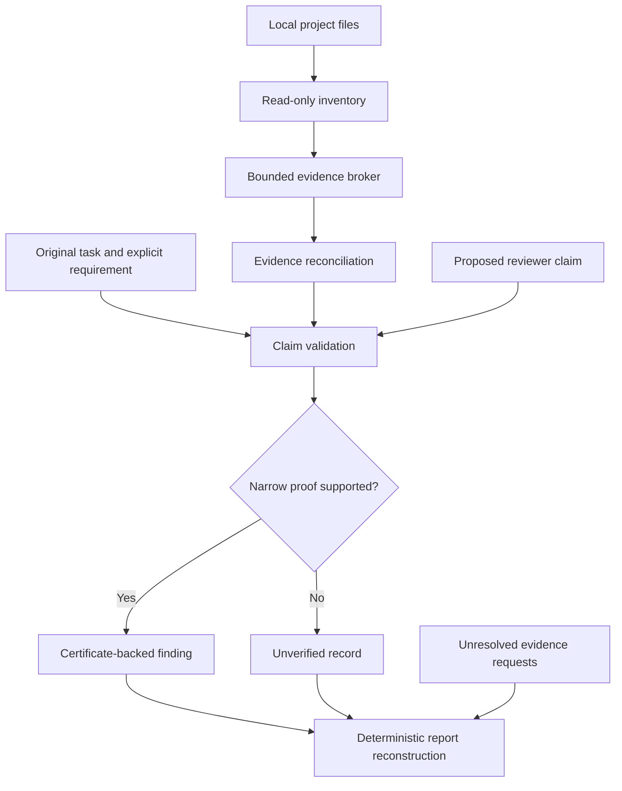

# Architecture and trust boundaries

[Overview](../README.md) · [Limitations](LIMITATIONS.md) · [Evaluation](EVALUATION_PROTOCOL.md)

## The boundary of R0

AI Council investigates whether specialist model reviews become more reliable when checked against shared evidence. **R0 exports the offline evidence and validation layer only.** It does not supply live agents, model selection, an orchestration runtime, a GUI or a benchmark harness.

The diagram below is a map of responsibilities, not a claim that the complete Council pipeline is present. The [offline demo](../examples/offline_demo.py) supplies a synthetic claim and evidence directly to the validator; it does not exercise every module.

## Six trust boundaries

| Boundary | Required distinction |
| --- | --- |
| **Source identity** | Paths, numbered lines and byte hashes must refer to the same observed source. A valid citation is not a semantic proof. |
| **Requirement authority** | A directly parsed, explicitly authorized requirement can support a small arithmetic subset. Tests and model comments do not create independent requirements. |
| **Evidence acquisition** | Correct target identity and usable source content matter. Alternatives, truncated queries and read failures must not count as fulfilled requests. |
| **Semantic certification** | Only supported deterministic patterns can be certified. Unsupported behavior remains unverified. |
| **Completeness** | Missing evidence must remain visible. A bounded `COMPLETE` status is not an exhaustive correctness guarantee. |
| **Report authority** | Reconstruct accepted facts from certified records rather than treating arbitrary reviewer prose as fact. |

## Module map

| Module | Responsibility |
| --- | --- |
| [`project_files.py`](../ai_council/project_files.py) | Project-file inventory helpers and filtering. |
| [`evidence.py`](../ai_council/evidence.py) | Bounded path/text/symbol retrieval with explicit read outcomes. |
| [`audit_provenance.py`](../ai_council/audit_provenance.py) | Citation validation, narrow source certificates, evidence-request accounting and final report reconstruction. |
| [`audit_session.py`](../ai_council/audit_session.py) | Evidence reconciliation, conflict detection and certificate-retention helpers. |
| [`schemas.py`](../ai_council/schemas.py) | Structured-output contracts. |
| [`schema_validation.py`](../ai_council/schema_validation.py) | Validation of the deliberately supported schema subset. |

## What the statuses do—and do not—say

**`VERIFIED` / `UNVERIFIED`** describe whether a particular claim has the required support under the implemented rules. They are not general labels for the quality of a program.

**`COMPLETE` / `INCOMPLETE`** describe completion of the bounded evidence work represented in a report. Neither status establishes that all possible defects have been examined.

**STOP on conflicting evidence** is a conservative boundary, not a proof of an atomic filesystem snapshot. Concurrency, source replacement and power-loss behavior require separate testing.

Before adding an adapter or widening a rule, specify its inputs, authoritative evidence, failure behavior and positive/negative controls. Start with the [evidence-result contract proposal](GOOD_FIRST_ISSUES.md#3-evidence-result-api-contract).
